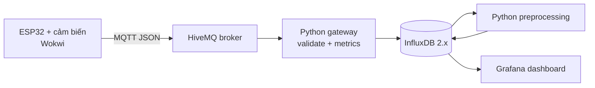

# Gợi ý nội dung báo cáo IoT Lab 2 (4-6 trang)

Thay các phần `[ĐIỀN ...]` bằng kết quả thật trong `results` và ảnh chụp màn hình.

## 1. Mục tiêu và kiến trúc hệ thống

Bài thực hành xây dựng pipeline dữ liệu IoT hoàn chỉnh. ESP32 được mô phỏng bằng
Wokwi, đọc DHT22, HC-SR04 và LDR, sau đó đóng gói dữ liệu JSON và truyền bằng
MQTT. Gateway Python kiểm tra tính hợp lệ trước khi ghi InfluxDB. Dữ liệu tiếp tục
được tiền xử lý và hiển thị bằng Grafana.



Chèn ảnh mạch Wokwi và ghi rõ chân kết nối: DHT22 GPIO15, HC-SR04 GPIO5/GPIO18,
LDR GPIO34, LED GPIO2.

## 2. Thu thập và kiểm tra dữ liệu

Topic chính là `ptit/iot/nhom15/esp32-01/telemetry`. Mỗi bản tin gồm định danh
thiết bị, số thứ tự gói, timestamp, uptime và các giá trị cảm biến.

```json
{
  "device_id": "esp32-01",
  "seq": 12,
  "ts": 1791350475123,
  "uptime_s": 60,
  "temperature": 25.1,
  "humidity": 50.2,
  "distance_cm": 100.88,
  "light_lux": 503.2,
  "rssi": -70
}
```

Gateway kiểm tra trường bắt buộc, kiểu số, miền giá trị và bản tin trùng theo cặp
`(seq, ts)`. Khoảng nhảy của `seq` dùng để ước lượng mất gói. Bản tin sai được lưu
ở `rejected_messages` để truy vết, còn dữ liệu hợp lệ vào `sensor_raw`.

Chèn ảnh terminal gateway và ghi tổng số:

| Chỉ số | Kết quả |
|---|---:|
| Bản tin hợp lệ | [ĐIỀN] |
| Bản tin bị loại | [ĐIỀN] |
| Bản tin trùng | [ĐIỀN] |
| Gói ước lượng bị mất | [ĐIỀN] |

## 3. Thiết kế lưu trữ

Hệ thống dùng InfluxDB 2.x vì dữ liệu có timestamp và chủ yếu được truy vấn theo
khoảng thời gian. `device_id` và `source` là tag; giá trị cảm biến là field.
Bucket có retention 7 ngày để tự động loại dữ liệu cũ, phù hợp môi trường lab.

Năm measurement gồm `sensor_raw`, `sensor_processed`, `ingest_metrics`,
`rejected_messages` và `device_status`. Timestamp của `sensor_raw` ưu tiên thời
gian thiết bị đã đồng bộ NTP; nếu đồng bộ thất bại thì gateway dùng thời gian nhận.

## 4. Tiền xử lý và đặc trưng

Dữ liệu được resample theo chu kỳ 10 giây. Giá trị thiếu được nội suy theo thời
gian. Ngoại lệ được phát hiện theo IQR: điểm nhỏ hơn `Q1 - 1.5*IQR` hoặc lớn hơn
`Q3 + 1.5*IQR` được coi là outlier rồi nội suy lại. Pipeline tạo thêm trung bình
trượt ba mẫu, độ biến thiên giữa hai mẫu liên tiếp và Z-score.

Điền kết quả từ `results/processing_summary.csv`:

| Biến | Missing trước xử lý | Outlier | Ghi chú |
|---|---:|---:|---|
| Temperature | [ĐIỀN] | [ĐIỀN] | IQR + interpolate |
| Humidity | [ĐIỀN] | [ĐIỀN] | IQR + interpolate |
| Distance | [ĐIỀN] | [ĐIỀN] | IQR + interpolate |
| Light | [ĐIỀN] | [ĐIỀN] | IQR + interpolate |

Chèn biểu đồ Grafana so sánh `temperature` raw với
`temperature_rolling_mean` để chứng minh hiệu quả làm mượt.

## 5. Độ trễ và đánh giá

Độ trễ một chiều được tính gần đúng bằng thời gian gateway nhận trừ timestamp
thiết bị. Thời gian ghi DB được đo quanh lệnh ghi InfluxDB. RTT được đo bằng cặp
topic `ping/pong` mỗi 30 giây.

| Đại lượng | Trung bình | Lớn nhất |
|---|---:|---:|
| Network delay | [ĐIỀN] ms | [ĐIỀN] ms |
| Database write | [ĐIỀN] ms | [ĐIỀN] ms |
| MQTT RTT | [ĐIỀN] ms | [ĐIỀN] ms |

Đánh giá: [ĐIỀN nhận xét về độ ổn định, thời điểm spike, ảnh hưởng của Internet và
tốc độ mô phỏng Wokwi].

## 6. Khó khăn, hạn chế và hướng phát triển

- Broker công cộng phụ thuộc Internet và không phù hợp dữ liệu bí mật.
- Wokwi có thể chạy chậm hơn thời gian thực nên số đo latency chỉ dùng cho lab.
- Dữ liệu ít làm ngưỡng IQR chưa ổn định; cần thu lâu hơn để đánh giá chính xác.
- Có thể phát triển bằng MQTT TLS, xác thực riêng, cảnh báo Grafana và triển khai
  broker Mosquitto nội bộ.

Kết luận: hệ thống đã thực hiện đủ chuỗi thu thập, truyền, kiểm tra, lưu trữ, tiền
xử lý, trực quan hóa và đánh giá chất lượng dữ liệu IoT.
